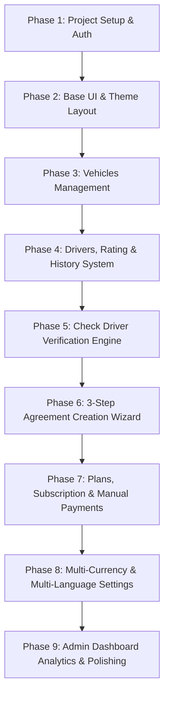

# Topd - Car Rental, Fleet Management & Driver Verification Platform

> একটি পূর্ণাঙ্গ **Car Rental, Fleet Management, Agreement Wizard এবং Driver Verification/Blacklist SaaS Platform**।  
> স্ক্রিনশট এবং প্রজেক্ট রিকোয়ারমেন্ট অনুযায়ী পাইথন ও **Django** ফ্রেমওয়ার্ক ব্যবহার করে ধাপে ধাপে তৈরির বিস্তারিত নির্দেশিকা।

---

## 📌 সূচিপত্র (Table of Contents)
1. [প্রজেক্ট ওভারভিউ (Overview)](#-প্রজেক্ট-ওভারভিউ-overview)
2. [মূল ফিচারসমূহ (Core Features)](#-মূল-ফিচারসমূহ-core-features)
3. [ইউজার রোল ও পারমিশন (User Roles & RBAC)](#-ইউজার-রোল-ও-পারমিশন-user-roles--rbac)
4. [টেকনোলজি স্ট্যাক (Tech Stack)](#-টেকনোলজি-স্ট্যাক-tech-stack)
5. [Django অ্যাপ আর্কিটেকচার (Modular Architecture)](#-django-অ্যাপ-আর্কিটেকচার-modular-architecture)
6. [ডাটাবেজ মডেল ও ফিল্ড ডিজাইন (Database Models)](#-ডাটাবেজ-মডেল-ও-ফিল্ড-ডিজাইন-database-models)
7. [ধাপে ধাপে বাস্তবায়ন পরিকল্পনা (Step-by-Step Implementation Roadmap)](#-ধাপে-ধাপে-বাস্তবায়ন-পরিকল্পনা-step-by-step-roadmap)
8. [লোকাল সেটআপ নির্দেশিকা (Setup Guide)](#-লোকাল-সেটআপ-নির্দেশিকা-setup-guide)

---

## 📖 প্রজেক্ট ওভারভিউ (Overview)
**Topd** এমন একটি ওয়েব প্ল্যাটফর্ম যার মাধ্যমে রেন্ট-এ-কার বা ভেহিকেল রেন্টাল কোম্পানিগুলো তাদের:
- গাড়ি ও ফ্লিট (Fleet) সহজে পরিচালনা করতে পারবে।
- ড্রাইভারদের তথ্য, রেটিং এবং অপরাধ/সমস্যার হিস্ট্রি (History Tracking/Blacklist) সংরক্ষণ করতে পারবে।
- অন্যান্য রেন্টাল কোম্পানি বা সাবস্ক্রাইবাররা কোনো ড্রাইভারকে গাড়ি দেওয়ার পূর্বে তার ব্যাকগ্রাউন্ড ভেরিফিকেশন (Check Driver) করতে পারবে।
- ৩-ধাপের ইন্টারেক্টিভ উইজার্ডের মাধ্যমে দ্রুত চুক্তি (Agreement/Contract) তৈরি, ডকুমেন্টস ও প্রি-রেন্টাল ছবি সংরক্ষণ করতে পারবে।
- সাবস্ক্রিপশন প্ল্যান ও ম্যানুয়াল পেমেন্ট (ক্যাশ / ব্যাংক ট্রান্সফার) অনুমোদন করতে পারবে।
- বহুভাষিক (English ও Russian) এবং একাধিক মুদ্রা (USD, KGS Som ইত্যাদি) পরিচালনা করতে পারবে।

---

## 🌟 মূল ফিচারসমূহ (Core Features)

### ১. অ্যাডমিন ও ইউজার ড্যাশবোর্ড (Dashboard Analytics)
- **মেট্রিক কার্ডস:** Total Subscribers, Active Subscribers, Pending Approval, One Time Orders।
- **চুক্তির হিসাব:** Total Contracts, Active Contracts, Total Payments Received।
- **গাড়ির অবস্থা:** Available, Rented, Leased, Maintenance কাউন্ট।
- **ড্রাইভার অবস্থা:** Total, Busy, Available, Bad/Warning কাউন্ট।
- **কুইক অ্যাকশন বাটন:** `Create Agreement`, `Check Driver`, `Subscribe Now`।

### ২. ড্রাইভার ভেরিফিকেশন ও ব্যাকগ্রাউন্ড চেক (Driver Check & Anti-Fraud Engine)
- ড্রাইভারের ফার্স্ট নেম, লাস্ট নেম, পাসপোর্ট নম্বর অথবা ১৪ ডিজিটের পার্সোনাল আইডি দিয়ে সার্চ।
- যে কোনো সাবস্ক্রাইবার বা অ্যাডমিন মুহূর্তেই জানতে পারবে কোনো ড্রাইভার পূর্বে গাড়ি নিয়ে পালিয়ে গেছে কিনা, জরিমানা বাকি রেখেছে কিনা বা অন্য কোনো অপরাধ রেকর্ড আছে কিনা।
- পে-পার-চেক (Pay-per-check) মডেল সমর্থন।

### ৩. ড্রাইভার ও ইনসিডেন্ট হিস্ট্রি ম্যানেজমেন্ট (Driver Management & Incident Log)
- ড্রাইভারের পূর্ণ বিবরণ: লাইসেন্স ও পাসপোর্ট কপি (PDF আপলোড), এক্সপায়ারি তারিখ।
- **ড্রাইভার হিস্ট্রি এন্ট্রি (Incident Logging):**
  - *Non-payment* (ভাড়া বা টাকা না দেওয়া)
  - *Disappeared or Ran Away* (গাড়ি বা টাকা নিয়ে পালিয়ে যাওয়া)
  - *Unpaid Fines* (ট্রাফিক জরিমানা বা কেস অনাদায়)
  - *Violation of Contract Terms* (চুক্তির শর্ত ভঙ্গ)
  - *Accident or Damage* (দুর্ঘটনা বা গাড়ির ক্ষতি)
  - *Fraud or Suspicious Behavior* (প্রতারণা বা সন্দেহজনক আচরণ)
  - *Other* (অন্যান্য সমস্যা)
- অ্যাডমিন ৫-স্টার রেটিং এবং অভ্যন্তরীণ কমেন্ট যোগ করার সুবিধা।

### ৪. ভেহিকেল / গ্যারেজ ম্যানেজমেন্ট (Vehicles Garage)
- ফিল্টারিং: Type, Status (Available, Rented, Leased, Maintenance), Year, Keyword Search।
- গাড়ি যোগ করার ফর্ম: Type, Title, Brand, Model, Year, Color, Registration Number, Description, Cover Image, অতিরিক্ত ছবি (সর্বোচ্চ ৫টি) এবং ডকুমেন্টস (সর্বোচ্চ ১৫টি)।

### ৫. ৩-স্টেপ চুক্তি উইজার্ড (3-Step Agreement / Contract Wizard)
- **Step 1 (Information):** 
  - Contract Type (Short-term Rental, Long-term Rental, Leasing, Installment, Vehicle Buyout)।
  - Company Name ও Client Name।
  - Select Vehicle ও Assign Driver (সিলেক্ট করার সাথে সাথে কার্ড আকারে গাড়ির ডিটেইলস ও ড্রাইভারের রেটিং/স্ট্যাটাস প্রিভিউ প্রদর্শন)।
  - Start Date ও End Date (ক্যালেন্ডার ও টাইম পিকার)।
  - Currency, Daily Rental Price, Deposit, Terms & Conditions এবং নোট/কমেন্ট।
- **Step 2 (Images):** 
  - গাড়ি হস্তান্তরের আগের ছবি বা ভিডিও (Before Agreement Image/Video)।
  - অতিরিক্ত প্রাসঙ্গিক ছবি আপলোড।
- **Step 3 (Documents):** 
  - অফিসিয়াল এগ্রিমেন্ট পিডিএফ ফাইল আপলোড ও ক্যাটাগরি নির্ধারণ।
- স্বয়ংক্রিয় ইউনিক কন্ট্রাক্ট নম্বর জেনারেশন (যেমন: `CONTRACT-2026-0001`)।

### ৬. সাবস্ক্রিপশন ও ম্যানুয়াল পেমেন্ট (Subscription & Manual Payments)
- **প্ল্যানসমূহ:**
  - Pay Per Check (এককালীন ড্রাইভার চেক)
  - Basic Plan (মাসিক)
  - Premium Plan (মাসিক ও বাৎসরিক)
- **পেমেন্ট গেটওয়ে:**
  - Stripe Integration (Stripe Plan ID ও Price ID)।
  - Manual Payments: ইউজার ক্যাশ অথবা ব্যাংক ট্রান্সফারের মাধ্যমে পেমেন্ট করে রসিদ/তথ্য সাবমিট করবে।
  - অ্যাডমিন প্যানেল থেকে ম্যানুয়াল পেমেন্ট ভেরিফাই করে `Pending` থেকে `Approved` বা `Cancelled` করা।

### ৭. সেটিংস ও ইন্টারন্যাশনালাইজেশন (Settings & Localization)
- **Multi-Currency:** USD (বেস কারেন্সি), KGS (Kyrgyzstani Som) এবং লাইভ বা ম্যানুয়াল এক্সচেঞ্জ রেট।
- **Multi-Language:** English (`EN`) এবং Russian (`Русский`) ভাষা টগল।
- **Website Settings:** সাইটের নাম, লোগো ও ফেভিকন আপলোড, যোগাযোগ তথ্য, সোশ্যাল মিডিয়া লিংক।
- **Appearance:** Light, Dark এবং System মোড।

---

## 👥 ইউজার রোল ও পারমিশন (User Roles & RBAC)

1. **Super Admin:** সমস্ত কন্ট্রোল, প্ল্যাটফর্ম সেটিংস, সকল সাবস্ক্রিপশন, ইউজার ম্যানেজমেন্ট ও পেমেন্ট অ্যাপ্রুভাল।
2. **Admin:** সাধারণ প্রশাসনিক কাজ, গাড়ি ও ড্রাইভার অনুমোদন, এগ্রিমেন্ট হ্যান্ডলিং।
3. **Individual / Company (Subscriber):** ফ্লিট ওনার বা রেন্টাল কোম্পানি। নিজস্ব গাড়ি ও ড্রাইভার যুক্ত করতে পারে, অন্যদের ড্রাইভার চেক করতে পারে, সাবস্ক্রিপশন কিনতে পারে।

---

## 💻 টেকনোলজি স্ট্যাক (Tech Stack)

| কম্পোনেন্ট | প্রযুক্তি |
| :--- | :--- |
| **Backend Framework** | Python 3.12+, **Django 5.x** |
| **Database** | **PostgreSQL** (প্রোডাকশন) / **SQLite** (ডেভেলপমেন্ট) |
| **Frontend UI** | **Tailwind CSS**, Alpine.js, HTML5, FontAwesome / Heroicons |
| **Dynamic Wizard / Forms** | **HTMX** / Django Formtools |
| **File Handling** | Pillow (ইমেজ প্রসেসিং), PDF File Validator |
| **Payment Gateways** | Stripe SDK + Manual Cash/Bank System |
| **Localization (i18n)** | Django `django.middleware.locale.LocaleMiddleware` + `gettext` |

---

## 🏗️ Django অ্যাপ আর্কিটেকচার (Modular Architecture)

```text
topd/
├── manage.py
├── topd_core/                     # Project configuration root
│   ├── settings.py
│   ├── urls.py
│   ├── wsgi.py
│   └── asgi.py
├── apps/
│   ├── accounts/                  # ইউজার মডেল, প্রোফাইল, রোল ও পারমিশন
│   │   ├── models.py
│   │   ├── views.py
│   │   └── urls.py
│   ├── vehicles/                  # গাড়ি, গ্যারেজ, ক্যাটাগরি, গাড়ির ডকুমেন্টস
│   │   ├── models.py
│   │   ├── views.py
│   │   └── urls.py
│   ├── drivers/                   # ড্রাইভার প্রোফাইল, ভেরিফিকেশন, রেটিং ও হিস্ট্রি
│   │   ├── models.py
│   │   ├── views.py
│   │   └── urls.py
│   ├── agreements/                # ৩-স্টেপ এগ্রিমেন্ট উইজার্ড ও কন্ট্রাক্ট ট্র্যাকিং
│   │   ├── models.py
│   │   ├── views.py
│   │   ├── forms.py
│   │   └── urls.py
│   ├── billing/                   # প্যাকেজ, সাবস্ক্রিপশন, স্ট্রাইপ ও ম্যানুয়াল পেমেন্ট
│   │   ├── models.py
│   │   ├── views.py
│   │   └── urls.py
│   └── dashboard/                 # অ্যাডমিন ও ইউজার ড্যাশবোর্ড মেট্রিকস ও চার্ট
│       ├── views.py
│       └── urls.py
│   └── site_settings/             # সাইট লোগো, নাম, কারেন্সি ও ল্যাঙ্গুয়েজ কনফিগ
│       ├── models.py
│       ├── views.py
│       └── urls.py
├── static/                        # CSS, JS, Images, Icons
├── media/                         # Uploaded vehicle photos, passport PDFs, agreements
└── templates/                     # Jinja/Django HTML Templates
    ├── base.html                  # Sidebar, Header, Language & Currency Switcher
    ├── dashboard/
    ├── agreements/
    ├── drivers/
    ├── vehicles/
    ├── billing/
    └── settings/
```

---

## 🗄️ ডাটাবেজ মডেল ও ফিল্ড ডিজাইন (Database Models)

### ১. `accounts.CustomUser` & `UserProfile`
- `email`: EmailField (Unique)
- `phone`: CharField
- `role`: Choices (`superadmin`, `admin`, `individual`, `company`)
- `status`: Choices (`pending`, `verified`, `suspended`)
- `company_name`: CharField (Optional)
- `business_type`: CharField
- `avatar`: ImageField

### ২. `vehicles.Vehicle`
- `title`: CharField
- `type`: Choices (`rent`, `lease`)
- `brand`: CharField (e.g. Hyundai)
- `model`: CharField (e.g. Sonata)
- `year`: PositiveIntegerField (e.g. 2019)
- `color`: CharField
- `registration_number`: CharField (Unique)
- `status`: Choices (`available`, `rented`, `leased`, `maintenance`)
- `cover_image`: ImageField
- `created_by`: FK(User)

### ৩. `drivers.Driver`, `DriverHistory` & `DriverRating`
- **Driver:**
  - `first_name`, `last_name`, `phone`, `email`
  - `passport_number`, `passport_expiry`
  - `license_number`, `license_expiry`
  - `personal_id`: CharField (14 Digits)
  - `status`: Choices (`available`, `busy`, `warning`, `inactive`)
  - `passport_copy_pdf`: FileField
  - `avatar`: ImageField
  - `approved_by`: FK(User, null=True)
- **DriverHistory:**
  - `driver`: FK(Driver)
  - `history_type`: Choices (`non_payment`, `ran_away`, `unpaid_fines`, `violation`, `accident`, `fraud`, `other`)
  - `incident_date`: DateField
  - `description`: TextField
  - `reported_by`: FK(User)
- **DriverRating:**
  - `driver`: FK(Driver)
  - `rating`: DecimalField (1.0 to 5.0)
  - `admin_comments`: TextField
  - `user_comments`: TextField

### ৪. `agreements.Agreement`, `AgreementMedia`, `AgreementDoc`
- **Agreement:**
  - `contract_number`: CharField (Auto-generated, e.g. `CONTRACT-2026-0001`)
  - `contract_type`: Choices (`short_term`, `long_term`, `leasing`, `installment`, `buyout`)
  - `company_name`: CharField
  - `client_name`: CharField
  - `vehicle`: FK(Vehicle)
  - `driver`: FK(Driver)
  - `start_date`: DateTimeField
  - `end_date`: DateTimeField
  - `currency`: CharField (Default: `KGS` or `USD`)
  - `daily_rental_price`: DecimalField
  - `deposit`: DecimalField
  - `terms_conditions`: TextField
  - `comments`: TextField
  - `status`: Choices (`active`, `completed`, `problem`, `cancelled`)
  - `created_by`: FK(User)
- **AgreementMedia & Doc:**
  - `agreement`: FK(Agreement)
  - `file`: FileField / ImageField
  - `category`: Choices (`before_rental`, `additional_photo`, `pdf_doc`)

### ৫. `billing.Plan`, `Subscription`, `ManualPayment`
- **Plan:** Name, Slug, Price, Interval (`once`, `monthly`, `yearly`), Stripe IDs, Features List.
- **Subscription:** User (FK), Plan (FK), Start Date, End Date, Status (`active`, `pending`, `expired`, `cancelled`).
- **ManualPayment:** User (FK), Plan (FK), Payment Method (`cash`, `bank_transfer`), Transaction Info, Amount, Status (`pending`, `approved`, `cancelled`).

---

## 🚀 ধাপে ধাপে বাস্তবায়ন পরিকল্পনা (Step-by-Step Roadmap)



### ✅ Phase 1: Environment & Project Setup
- [x] Python Virtual Environment তৈরি করা (`venv`)।
- [x] Django ও প্রয়োজনীয় প্যাকেজসমূহ ইনস্টল করা (`Django 5.1`, `Pillow`, `django-htmx`, `python-dotenv`)।
- [x] Django প্রজেক্ট তৈরি ও Custom User মডেলের সাথে `accounts` অ্যাপ কনফিগার করা।
- [x] সকল ডাটাবেজ মডেল তৈরি ও সফলভাবে মাইগ্রেশন অ্যাপ্লাই করা।
- [x] সুপারইউজার ও ইনিশিয়াল সিড ডাটা (Currencies, Plans, Settings) তৈরি করা।

### ✅ Phase 2: Base UI & Landing Page (আপলোড করা স্ক্রিনশট অনুযায়ী)
- [x] Tailwind CSS ও FontAwesome আইকন কনফিগারেশন।
- [x] ল্যান্ডিং পেজ (`templates/landing/index.html`) হুবহু রেফারেন্স ডিজাইনে তৈরি:
  - **Navbar:** লোগো (Red Car + Topd), Home, About, Features, Pricing, Contact, Dashboard, Check Driver, Language Switcher (EN/RU)।
  - **Hero Section:** ডার্ক পার্কিং ফ্লিট ব্যাকগ্রাউন্ড, হেডলাইন *"Kyrgyzstan's First Unified Vehicle Rental Platform"*, সাবটাইটেল এবং `Get Started` ও `Check Data` অ্যাকশন বাটন।
  - **How It Works:** ৩টি ধাপ (Register, Create Contract, Track & Earn) গোল লাল ব্যাজ আইকনসহ।
  - **Who It's For:** ৩টি স্টেকহোল্ডার কার্ড (Rental Companies, Leasing Providers, Private Owner)।
  - **Key Benefits:** ৬টি গ্রিড ফিচার (Driver Ratings, Daily Payment Logs, Streamlined Contracts, Analytics Dashboard, Mobile Friendly, Secure Platform)।
  - **Our Pricing Models:** Pay-per-Check ($2) এবং Premium Subscription ($10) Best Value রিবন সহ।
  - **CTA Banner:** লাল ব্যাকগ্রাউন্ডের হাই-কনভার্শন সেকশন।
  - **Contact Us:** ডাইনামিক কন্টাক্ট ফর্ম (ডাটাবেজে সেভ হয়) এবং ঠিকানা, ফোন, ইমেইল ও কাজের সময়।
  - **Footer:** ৪-কলামের ডার্ক ফুটার ও সোশ্যাল মিডিয়া লিংক।

### ✅ Phase 3: Vehicles Garage Module
- [ ] `Vehicle` এবং `VehicleDocument` মডেল তৈরি ও মাইগ্রেশন।
- [ ] গাড়ির তালিকা পেজ (কার্ড/টেবিল ভিউ, ফিল্টারিং: Type, Status, Year)।
- [ ] গাড়ি যোগ/এডিট করার ফর্ম (ইমেজ প্রিভিউ ও মাল্টিপল ডকুমেন্ট আপলোডসহ)।

### ✅ Phase 4: Drivers & History Module
- [ ] `Driver`, `DriverHistory` ও `DriverRating` মডেল তৈরি।
- [ ] ড্রাইভার তালিকা (রেটিং ব্যাজ, স্ট্যাটাস ব্যাজ ও অ্যাকশন বাটন)।
- [ ] নতুন ড্রাইভার যুক্ত করার ফর্ম (পাসপোর্ট PDF ও ছবি আপলোড)।
- [ ] ড্রাইভার প্রোফাইল ভিউ (`/my-drivers/{id}`): স্ট্যাটাস কাউন্টার, লাইসেন্স মেয়াদ ও ডিটেইলস।
- [ ] ড্রাইভারের অপরাধ বা সমস্যার হিস্ট্রি লগ এন্ট্রি (`/drivers/{id}/history`) এবং স্টার রেটিং সিস্টেম।

### ✅ Phase 5: Check Driver Verification Tool
- [ ] `/check-driver` পেজ তৈরি।
- [ ] ড্রাইভারের ফার্স্ট নেম, লাস্ট নেম, পাসপোর্ট নম্বর অথবা আইডি দিয়ে গ্লোবাল সার্চ কুয়েরি।
- [ ] সার্চ রেজাল্টে ড্রাইভারের কোনো পূর্বের রিপোর্ট/হিস্ট্রি থাকলে তা ওয়ার্নিং সহ প্রদর্শন।

### ✅ Phase 6: 3-Step Agreement System
- [ ] `Agreement` মডেল ও রিলেটেড মিডিয়া/ডকুমেন্ট মডেল তৈরি।
- [ ] ৩-ধাপের ফর্ম উইজার্ড (Step 1: Info, Step 2: Images, Step 3: Documents)।
- [ ] গাড়ি বা ড্রাইভার সিলেক্ট করলে রিয়েল-টাইম তথ্য ও কার্ড প্রিভিউ (HTMX দিয়ে)।
- [ ] এগ্রিমেন্ট তালিকা পেজ (ট্যাব ফিল্টার: `All`, `Active`, `Completed`, `Problem`, `Cancelled`)।

### ✅ Phase 7: Subscriptions & Manual Payments
- [ ] প্ল্যান ও সাবস্ক্রিপশন মডেল তৈরি।
- [ ] সাবস্ক্রিপশন পেজ (`/manual-subscriptions/create`): Pay Per Check, Premium Monthly, Premium Yearly প্ল্যান কার্ড।
- [ ] ক্যাশ ও ব্যাংক ট্রান্সফার দিয়ে ম্যানুয়াল পেমেন্ট রিকোয়েস্ট সাবমিশন।
- [ ] অ্যাডমিন প্যানেল থেকে পেন্ডিং পেমেন্ট ভেরিফাই ও অনুমোদন (`Approved`) করার ব্যবস্থা।

### ✅ Phase 8: Currency, Language & Settings
- [x] কারেন্সি সেটিংস (USD এবং KGS exchange rate কনফিগারেশন)।
- [x] Multi-Language (English `EN` ও Russian `RU`) ফুল-ডাইনামিক ট্রান্সলেশন সিস্টেম তৈরি:
  - উইন্ডোজ প্ল্যাটফর্মে কোনো এক্সটার্নাল C-বাইনারি বা gettext নির্ভরতা ছাড়া লাইটওয়েট বাইলিঙ্গুয়াল ইঞ্জিন।
  - ল্যান্ডিং পেজ এবং ৩টি ড্যাশবোর্ডের সমস্ত টেক্সট, বাটন, হেডিং এবং মেনু তাৎক্ষণিকভাবে টগল হয়।
  - কুকি ও সেশনের মাধ্যমে ইউজারের পছন্দমতো ভাষা ব্রাউজারে স্থায়ীভাবে সংরক্ষিত থাকে।
- [x] সাইটের সাধারণ সেটিংস (লোগো, ফেভিকন, নাম, যোগাযোগ নম্বর, সোশ্যাল লিংক)।

### ✅ Phase 9: Three Dedicated Dashboards (Super Admin, Fleet Admin & Driver)
- [x] **1. Super Admin Dashboard (`/dashboard/superadmin/`):**
  - সম্পূর্ণ প্ল্যাটফর্মের Subscriber Metrics (Total, Active, Pending, One Time Orders)।
  - আয় ও রেভিনিউ হিসাব (Payments Received: KGS 2,623.50+)।
  - প্ল্যাটফর্ম ভেহিকেল ও ড্রাইভার স্ট্যাটাস।
  - ফুল মাস্টার কন্ট্রোল সাইডবার (Agreements, Drivers, Vehicles, Manual Payments, Subscriptions, Users, Settings, Plans)।
- [x] **2. Rental Company / Fleet Admin Dashboard (`/dashboard/admin/`):**
  - রেন্টাল এজেন্সির নিজস্ব গ্যারেজ গাড়ি (Total Garage, Available, Rented, Maintenance)।
  - নিজস্ব নিয়োজিত ড্রাইভার ও লাইভ কন্ট্রাক্ট তালিকা।
  - My Subscription কার্ড (প্ল্যান স্ট্যাটাস ও রিনিউয়াল)।
  - Check Driver এন্টি-ফ্রড ভেরিফিকেশন ইঞ্জিন।
- [x] **3. Driver Dedicated Portal Dashboard (`/dashboard/driver/`):**
  - ড্রাইভার প্রোফাইল, লাইসেন্স নম্বর ও মেয়াদ, পাসপোর্ট নম্বর ও মেয়াদ, ১৪ ডিজিটের পার্সোনাল আইডি।
  - ৬টি পারফরম্যান্স মেট্রিকস: Total Agreements, Active, Completed, Problems, Total Issues, Completion Rate (100%), Total Reviews।
  - বর্তমান নিয়োজিত গাড়ি (Current Assigned Vehicle: Hyundai Sonata 2019, 01KG777AAA)।
  - ড্রাইভার ইনসিডেন্ট হিস্ট্রি লগ (জরিমানা/অপ্রীতিকর ঘটনা ট্র্যাকিং) এবং অ্যাডমিন রেটিং (4.8 / 5.0)।
- [x] টপ নেভিগেশন বারে ওয়ান-ক্লিক **লাইভ রোল সুইচার** (1. Super Admin / 2. Fleet Admin / 3. Driver)।
- [x] **কাস্টম ফ্রন্টএন্ড ভিউজ ও ১০০% জ্যাঙ্গো এডমিন ফ্রি সাইডবার:**
  - এগ্রিমেন্টস তালিকা ও ৩-ধাপের উইজার্ড (`/agreements/`, `/agreements/create/`)
  - ড্রাইভার্স তালিকা, ড্রাইভ রেজিস্ট্রেশন ফর্ম ও ডেডিকেটেড চেক ইঞ্জিন (`/drivers/`, `/drivers/create/`, `/drivers/check/`)
  - ভেহিকেল গ্যারেজ ইনভেন্টরি ও গাড়ি যোগ ফর্ম (`/vehicles/`, `/vehicles/create/`)
  - বিলিং ম্যানুয়াল পেমেন্টস, সাবস্ক্রিপশন ও প্ল্যানস (`/billing/manual-payments/`, `/billing/subscriptions/`, `/billing/plans/`)
  - ইউজার ম্যানেজমেন্ট ও রোল ফিল্টারিং (`/accounts/users/`)
  - সিস্টেম ও ওয়েবসাইট সেটিংস (`/settings/`)
  - সাইডবারের কোনো লিংকেই আর জ্যাঙ্গোর ডিফল্ট `/admin/` এ রিডাইরেক্ট করে না, পুরোটাই আধুনিক Vuexy / Ynex থিমের মধ্যে থাকে।

---

## 🛠️ লোকাল সেটআপ নির্দেশিকা (Setup Guide)

### ১. ভার্চুয়াল এনভায়রনমেন্ট তৈরি ও এক্টিভেট:
```bash
python -m venv venv
# Windows:
.\venv\Scripts\activate
# Linux/Mac:
source venv/bin/activate
```

### ২. ডিপেন্ডেন্সি ইনস্টল:
```bash
pip install django pillow htmx stripe python-dotenv
```

### ৩. মাইগ্রেশন ও সুপারইউজার তৈরি:
```bash
python manage.py makemigrations
python manage.py migrate
python manage.py createsuperuser
```

### ৪. সার্ভার চালু:
```bash
python manage.py runserver
```
ব্রাউজারে ভিজিট করুন: `http://127.0.0.1:8000/`

---
*প্রস্তুতকারক: Google Antigravity AI Assistant*

# FleetManagement


Super Admin:
Email: admin@topd.kg
Password: admin123

Rental Agency:
Email: company@topd.kg
Password: company123


Driver:
Email: driver@topd.kg
Password: driver123